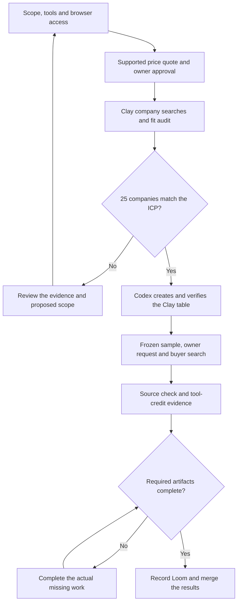

# Swvl GTM Research Lab

Build a market map, a real Clay table, and a measured buyer-search experiment with Codex CLI. This is GTMENA Team 03 Pipeline's practical guide to Session 6, with a reproducible workflow teammates can adapt and demonstrate in their portfolios.

**Start with [the setup guide](docs/01-setup.md), then follow [the execution steps](docs/02-execute.md).** Codex does the research, creates and populates the Clay table, checks the results, and prepares the evidence. You choose the hypothesis, approve the proposed spending, inspect the results, and record your Loom.

**Research status:** guide and tooling available; no completed live run is claimed. [Submission index](SUBMISSION.md).

## What you will produce

| Deliverable | What it contains |
| --- | --- |
| Clay workbook/table | At least 25 matching companies, with company name, website, and company-page link |
| Market map | Three nested Clay searches: TAM, SAM, and a next-30-day SOM; actual counts with labels |
| Buyer experiment | Five sampled companies, two requested people each, a rule adopted before the search, and an honest decision |
| Tool and credit report | Each tool's job, actual calls, approval, known charges, unknown charges, and supporting evidence |
| Class package | Four-line Task 1 note, three-line Task 2 note, Codex session copy, and three-minute Loom link |

## Run it

Open Codex in this repository and paste:

```text
Read AGENTS.md and prompts/codex.md and execute the guide.
My Session 6 task PDF is at: [actual local path].
Use the available browser connection to create and populate the Clay
table when the Clay connector cannot write tables.
Before spending, show me the supported quote and ask me to approve
up to X Clay credits, with the separate action/search limits if applicable.
Complete the work within that approval, record tool/cost evidence,
and prepare the results branch for my Loom and final merge.
```

The complete prompt is [prompts/codex.md](prompts/codex.md). The setup guide explains how to verify actual tool access and browser control before a paid operation. No provider price is hardcoded.

## Follow the guide

1. [Connect Codex, Clay, and browser access](docs/01-setup.md).
2. [Choose, approve, execute, and inspect](docs/02-execute.md).
3. [Understand the research decisions](docs/03-method.md).
4. [See exactly what each tool does and how credits are evidenced](docs/04-tools-and-credits.md).
5. [Record the Loom using the guide and real work](docs/05-loom.md).
6. [Check, submit, and merge the results](docs/06-results-and-merge.md).

## Workflow



## Local checks

Python 3.10+ and the standard library are sufficient:

```text
python scripts/audit.py repo
python -m unittest discover -s tests -v
python scripts/audit.py usage results/YOUR_RUN
python scripts/audit.py ready results/YOUR_RUN
```

On Windows, use `py -3` if that is your Python launcher. These checks validate packaging, declared data, and cost accounting; sources and account access still require actual inspection. A failed buyer hypothesis can be a complete experiment. Missing required evidence or deliverables cannot.

## Ownership

Ahmed Yassin initiated this project for GTMENA Team 03 Pipeline. [Contribute a named run](CONTRIBUTING.md), keep the team's attribution, and describe your actual contribution in your portfolio. Original material is MIT-licensed; external sources, provider data, and course materials retain their respective rights. This is independent coursework, not an approved Swvl commercial offer.
