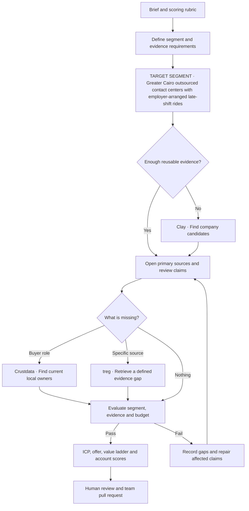

# Swvl GTM Research Playbook

A reproducible research workflow from GTMENA Cohort 01, Team 03 Pipeline. Start with a transport problem, qualify a segment, build an offer, and prioritize accounts using evidence and a controlled tool budget.

**Our segment** is outsourced contact centers in Greater Cairo that already arrange employee rides for late shifts. **Our buyer** is the Facilities or Transport Manager who operates the service, with Finance or Procurement involved in commercial approval.

The proposed offer pairs managed late-shift transport with records that Finance can match to billed runs. The purchase case still depends on the buyer's own records and Swvl's route economics.

## Start here

1. Read [why we chose the segment](docs/segment-decision.md).
2. Run the saved case locally with Python 3.10 or newer. This uses zero provider credits.

   ```bash
   python scripts/evaluate.py data/baseline.json
   python scripts/render_scorecard.py data/baseline.json
   python -m unittest discover -s evals -v
   ```

   On Windows, use `py -3` instead of `python` if needed. The renderer prints Markdown to the terminal. The saved version is in [case-study/account-scorecard.md](case-study/account-scorecard.md).

3. For fresh research, follow [how to run](docs/how-to-run.md), connect tools using [MCP setup](docs/mcp-setup.md), and paste [the complete Codex prompt](prompts/codex-run.md).
4. Review evidence using [the evaluation protocol](docs/evaluations.md) before sharing a new release.

## How the workflow fits together



The [architecture and research map](docs/architecture.md) show the five work stages and the tool handoffs in more detail.

## What is included

| Area | What you get |
| --- | --- |
| [Case study](case-study/market-and-icp.md) | Market alternatives, ICP, buying committee, offer stack and value ladder |
| [Saved dataset](data/baseline.json) | All 25 original account rows, five scores each, rationales, and 82 resolved source URLs |
| [Tool routing](docs/tool-routing.md) | A specific job for Clay, Crustdata, treg, browsing, Drive and GitHub |
| [Prompts](prompts/codex-run.md) | Replay, preview, full research, refresh and independent review |
| [Evaluations](docs/evaluations.md) | Executable checks, adversarial test cases and a required human evidence review |
| [Contribution guide](CONTRIBUTING.md) | Small PR workflow, review responsibilities and portfolio attribution |

The [team roadmap](docs/roadmap.md) lists the next research and validation tasks. [Publishing instructions](docs/publishing.md) cover creating the GitHub repository and using the portable files.

Everything in this repository is text. Mermaid stays editable inside Markdown. The Python tools use the standard library and run offline. Fresh provider research is agent-driven through connected tools.

## What the saved run proves

The original 8 November 2026 snapshot contains 25 scored operators. Its routing is 4 priority discovery, 10 discovery queue, 6 verify first, 4 CRM review, and 1 excluded campaign. These are historical screening outcomes.

The import preserves the original judgments and links. It has **pending human evidence review**. Passing the offline checks establishes structural consistency and reproducible routing. Current buyer roles, trigger dates, source availability and actual purchase intent need a fresh review.

The earlier research reported Clay, Crustdata, treg, public-source verification and Google Drive use. Exact historical calls and credit totals were not retained. [Provenance](case-study/provenance.md) explains the limits. New runs must log actual tool use and costs.

## Team ownership

Ahmed Yassin initiated this workflow for Team 03 Pipeline. Each contributor can add evidence, improve prompts, challenge scores, test the evaluator, or develop the case. Use [CONTRIBUTORS.md](CONTRIBUTORS.md) to record your contribution and [the portfolio guide](docs/portfolio.md) to describe your own work accurately.

Original repository material uses the [MIT license](LICENSE). External articles, provider data and GTMENA's original teaching templates keep their respective rights. Swvl has not approved the proposed commercial terms.
