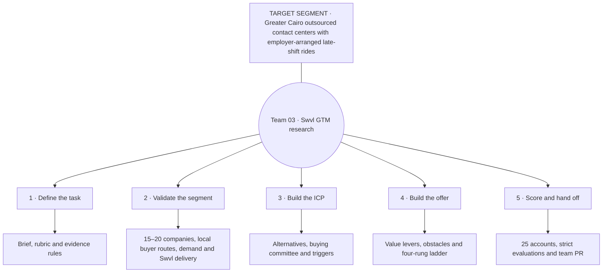
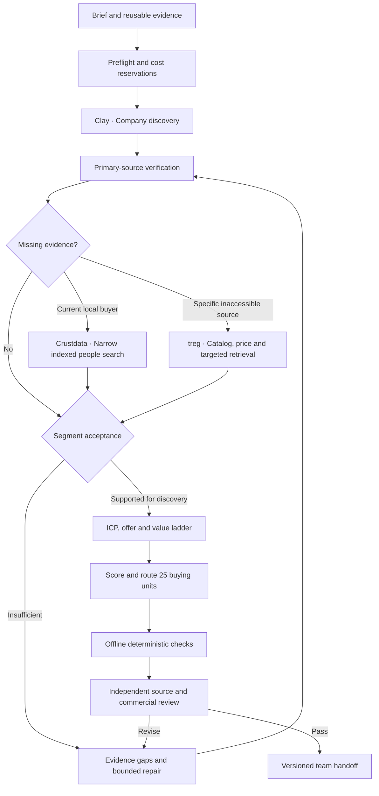

# Architecture and research map

The target segment stays visible beside the five work stages. Each stage creates a reviewable artifact before the next stage.

## Tool handoffs and gates

REPLAY bypasses all external retrieval and uses the saved evidence snapshot. PREVIEW exercises the same gates on three accounts. FULL targets 25. REFRESH reopens only evidence that is stale, missing or contradicted.

Source observations flow into `run.json`. The scorecard is rendered from that file. Narrative files cite the same registry, and the evaluation report states which claims remain uncertain. Drive is an optional export destination after review.
