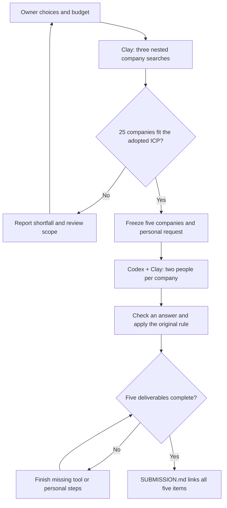

# Session 6: map the market and test a buyer hypothesis

**Current status: restart materials prepared; the new research has not run.**

Use the [submission index](SUBMISSION.md) as the single entry point for the team leader. It becomes a submission when the five actual deliverables are linked and the class checks pass.

## Start again

1. Follow [your personal steps](manual-steps.md).
2. Open a fresh Codex session in this folder.
3. Ask it to read and execute the [full restart prompt](restart-codex.md).
4. Keep the source PDF locally outside Git. Configure its real path in the first message.

From the repository root:

```text
cd sessions/session-06
codex
```

Then paste:

```text
Read AGENTS.md and restart-codex.md and execute the Session 6 restart.
The task PDF is at: [paste the actual local path].
Use Codex with Clay for both tasks. Preserve all earlier runs.
Collect the necessary decisions once, complete the supported work,
and publish the sanitized package through the repository workflow.
```

Use the same terminal environment as your existing MCP setup. Check `codex mcp list` before starting, or `/mcp` inside Codex, if access is uncertain. The actual exposed capabilities determine what can be automated. [Official MCP guidance](https://learn.chatgpt.com/docs/extend/mcp)

## What changes in this restart

The earlier attempt required proof of employer-arranged late-shift transport to count every company. It found a small publicly evidenced subset and sparse Facilities-role results. The restart maps the broader company ICP first and labels transport evidence separately. This is a deliberate ICP revision for a new experiment, not a relabeling of the previous results.

**Proposed company ICP:** outsourced contact-center operators with a verified Greater Cairo operating site; all company sizes, with no numeric headcount filter. Exclude recruitment-only firms, software-only vendors, and companies without the relevant operating presence.

The Swvl offer still concerns late-shift employee transport. Existing transport policy, operational pain, route density, budget, and signing authority are discovery questions. Finding 25 matching companies does not establish 25 ready buyers.

**Proposed new title family:** Transport Manager, Transportation Manager, Transportation Supervisor, Head of Transportation. Confirm that this family is distinct from the other teammates' choices. Facilities remains a documented previous experiment; its low yield is prior information, not hidden.

Neither this company definition nor a new title family guarantees 25 firms or ten returned people. If the company count is genuinely too small, record the count and obtain a clearly recorded scope revision. Do not fill the list with unrelated firms.



## Checks and contributions

```text
python -m unittest discover -s sessions/session-06/tests -v
python sessions/session-06/check_submission.py sessions/session-06/runs/YOUR_RUN --ready
```

Run these from the repository root. On Windows, `py -3` can replace `python`. The template deliberately fails readiness; the checker can calculate counts even when a buyer hypothesis fails. A separate teammate's research-release sign-off is not a prerequisite to the class package.

For team reuse, create your own run folder, record your name and actual contribution, and use a branch/PR. Do not overwrite Ahmed's or another teammate's run. See [requirements](requirements.md), [the data contract](DATA.md), [the experiment template](templates/session.json), and [the team table template](templates/team-summary.md).
